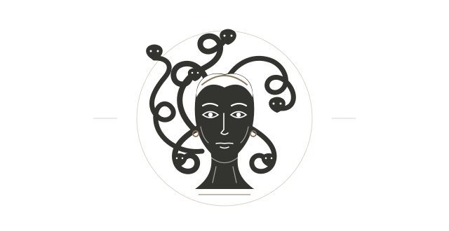

<picture>
  <source media="(prefers-color-scheme: dark)" srcset="assets/hero-still-dark.svg" />
  
</picture>

# Youssef Ouhaghi Ahmian

**AI product & forward deployed engineer · Founder of [mokka](https://mokka-agentur.de)**

I put AI into the systems companies already run, and I write the tools that show whether it works. 
My work spans production deployments, published model weights, and reproducible evaluations.

[In production](#in-production) &nbsp; / &nbsp; [Models & research](#models--research) &nbsp; / &nbsp; [Applications](#applications) &nbsp; / &nbsp; [Developer tools](#developer-tools)

[Hugging Face](https://huggingface.co/Gjusev) · [Kaggle](https://www.kaggle.com/gjusev) · [LinkedIn](https://www.linkedin.com/in/youssef-o-6b93611b7/) · [mokka](https://mokka-agentur.de)

Open to EU and relocation

---

## In production

Software that clients use, built and deployed end to end at mokka:

- **Nexary**: an enterprise knowledge platform deployed inside a client's own network for data sovereignty. Hybrid search (dense + BM25), cross-encoder reranking, and ingestion of text, OCR scans, and images. [Public portfolio export](https://github.com/Gjusev/nexary-platform).
- **[Datenmaske](https://datenmaske.de)**: GDPR PDF redaction for law firms and public authorities, fully offline. NER plus rules; detection recall went from 75% to 85% on a 1,428-entity planted benchmark.
- **[Klarbescheid](https://klarbescheid.de)**: retrieval over real administrative notices that explains them in plain language and flags likely errors. From an unfamiliar domain to a shipped product in six weeks.

mokka runs alongside my full-time job as a software engineer for enterprise clients, where I build REST APIs and integrations into the systems they already run and lead development on two accounts. Four years of professional software engineering in total.

## Models & research

### [MK-SH-1](https://github.com/Gjusev/MK-SH-1)

**A 140M-parameter decision model with calibrated confidence and abstention.**

I fine-tuned an mmBERT-small encoder to score described options against a state and a question. It returns probabilities and a choice, or abstains below its confidence threshold. The training work investigates numeric threshold comparisons and uses replay mixing to retain the original routing task.

Published weights, a CPU demo, training code, and an experiment record with corrected results. Calibration improves confidence estimates; its fitted risk budget does not hold on every held-out distribution.

[Model weights & card](https://huggingface.co/Gjusev/MK-SH-1) · [Try the model](https://huggingface.co/spaces/Gjusev/MK-SH-1-demo) · [Training & evaluation](https://github.com/Gjusev/MK-SH-1#reproduce)

Inside the research: measurements and their limits

| Measurement | Published result | Scope |
| --- | --- | --- |
| Numeric threshold accuracy | 97.9% | 48 known-threshold examples |
| Fresh extreme thresholds | 87.5% | 56 examples; 7 of 8 pairs |
| Original routing task | 80.0% | 300-row evaluation slice |
| Calibration error | 0.073 → 0.016 | 480-question calibration split; fitted on this split |
| Abstention policy | 90% coverage, 4.86% selective risk | In-sample; held-out risk reaches 8.2% on fresh OOD and 7.3% on routing |

These are bounded research measurements. The [model card](https://huggingface.co/Gjusev/MK-SH-1#calibration--abstention-v12-experiment-e36) records sample sizes, uncertainty, and where the policy misses its target. The encoder comes from [JHU CLSP](https://huggingface.co/jhu-clsp/mmBERT-small); the training, evaluation, and calibration system is in my repository.

### [MK-SH-V](https://github.com/Gjusev/mk-sh-v)

**A 260M-parameter visual decision model, the image sibling of MK-SH-1.**

It reads a document page or a screenshot together with a question and described options in one encoder pass. It returns calibrated probabilities and a choice, or refuses when its confidence falls below a gate whose risk was validated on held-out data. On real held-out screenshots it beats a model about 15 times its size run zero-shot; on receipt thresholds it does not.

Published weights, a CPU demo with real cases it answers and cases it refuses, training code, and criteria frozen before every experiment. On real images the gate does not yet separate right from wrong answers; that is the next experiment.

[Model weights & card](https://huggingface.co/Gjusev/MK-SH-V) · [Try the model](https://huggingface.co/spaces/Gjusev/MK-SH-V-demo) · [Results & limits](https://github.com/Gjusev/mk-sh-v#measured-against-the-field)

Inside the research: measurements and their limits

| Measurement | Published result | Scope |
| --- | --- | --- |
| Real screenshots | 0.826 and 0.783 (two seeds) | GUI-Odyssey held out; a ~4B model zero-shot scores 0.731 |
| Real receipt thresholds | 0.550 and 0.602 | CORD held out; the ~4B model scores 0.972 and a rules baseline 0.594 |
| Effect of adding real training data | 0.471 → 0.765 overall (+29.4 pp, CI95 [+25.9, +32.9]) | 2,586 real held-out cases, seed 42; −2.5 pp on the synthetic test |
| Refusal gate at τ 0.55 | 86% coverage, 95% Clopper-Pearson risk bound 3.2 to 3.4% | Held-out synthetic test, both seeds, 5% budget |
| Same gate on real images | 17 to 21% risk on screenshots; 2 to 12% coverage on receipts | Outside the budget: the open problem of the campaign |

Every arm was run on the same rows with pinned revisions. The [README](https://github.com/Gjusev/mk-sh-v#rigor) records a mislabel corrected in public and a threshold rule replaced before it was reused.

### [laya-triage](https://github.com/Gjusev/laya-triage)

**Support-ticket routing with a published BANKING77 fine-tune.** Two stages narrow 77 intents into 12 clusters and 8 departments, with urgency signals and confidence-based human handoff. The fine-tuned pipeline reached **89.8% intent accuracy on the full 3,080-ticket BANKING77 test split**. Multilingual routing is available; the published fine-tune and headline result are English.

[Fine-tuned checkpoint](https://huggingface.co/Gjusev/laya-triage-banking77) · [App](https://laya-triage-8spuhg8fa5qjy8hiteomux.streamlit.app/) · [Results & limitations](https://github.com/Gjusev/laya-triage#measured-results)

### [VoxEntity-EU](https://github.com/Gjusev/voxentity-eu)

**Did the voice system capture the exact phone number?** A benchmark for names, phone numbers, emails, dates, addresses, and reference codes in German and French. It compares clean speech with a simulated telephone channel, with separate extensions for corrections, code-switching, voices, and Spanish.

The corpus is **provisional**: speech is synthetic, the channel is simulated, and systematic human review is pending. The dataset and results browser let you inspect and listen to individual failures.

[Dataset](https://huggingface.co/datasets/Gjusev/voxentity-eu) · [Listen & inspect results](https://huggingface.co/spaces/Gjusev/voxentity-eu-results) · [Reproduce](https://github.com/Gjusev/voxentity-eu#reproduce-on-a-cpu)

### [gate-calibrated](https://github.com/Gjusev/gate-calibrated)

**When should a tool-using agent act, and when should it ask?** A calibrated approval gate with a LangGraph integration and a reproducible tau-bench retail evaluation. The study measures wrong writes against approval burden and reports the negative result: calibration did not establish an advantage over simple alternatives under the tested setup.

[Results](https://github.com/Gjusev/gate-calibrated#main-result) · [Agent integration](https://github.com/Gjusev/gate-calibrated#use-the-gate-in-your-own-agent)

## Applications

### [note-lm](https://github.com/Gjusev/note-lm)

**A research notebook that keeps the passage behind each claim.** Import documents, pages, audio, or video; save claims against immutable source versions; review what changed when a source is re-imported. Local search, models, and transcription by default, with optional remote providers.

[Download for Windows](https://github.com/Gjusev/note-lm/releases/latest) · [Watch the demo](https://github.com/Gjusev/note-lm#see-it-in-20-seconds) · [Architecture](https://github.com/Gjusev/note-lm/blob/main/ARCHITECTURE.md)

### [HeizPro KI](https://github.com/Gjusev/heizpro-ki)

**A German-speaking voice agent for heating-service enquiries.** Qualifies a caller's needs, location, and urgency, then saves a structured lead for follow-up. Includes a lead dashboard and a two-agent simulator for exercising conversations.

[Voice demo](https://mischa.mokka-dev.de) · [Source & setup](https://github.com/Gjusev/heizpro-ki#run-it)

More applications: RAG, meal planning, wearable data, and business workflows

- **[Nexary platform](https://github.com/Gjusev/nexary-platform)**: multi-provider chat, hybrid RAG, and audit export for customer-controlled infrastructure. Public portfolio export; a fresh end-to-end deployment remains unverified.
- **[Nexary website](https://github.com/Gjusev/nexary)**: the separate German, English, and Spanish marketing frontend, with light/dark themes and a configurable application handoff.
- **[Maqrivo](https://github.com/Gjusev/maqrivo)**: self-hosted meal planning and grocery optimization. AI proposes recipes, deterministic code calculates nutrition, and CP-SAT selects a plan using pantry stock and observed prices. Active development; price coverage depends on available observations.
- **[Somatriq](https://github.com/Gjusev/somatriq)**: self-hosted wearable data, versioned calculations, and personal experiments. Active prototype; mobile sync and hardware acceptance remain open.
- **[Studio Command Center](https://github.com/Gjusev/studio-command-center)**: fitness-studio inventory, equipment maintenance, staff tasks, and operational records. Portfolio prototype with seeded demonstration data.
- **[Falschinfo-Radar](https://github.com/Gjusev/falschinfo-radar)**: discovers German nutrition videos, extracts claims for review, and drafts corrections. Application project; fresh end-to-end discovery requires provider keys and remains unverified in the public export.

## Developer tools

### [nitelos](https://github.com/Gjusev/nitelos)

**Did the agent really do what it says it did?** A small Python SDK: you write down what "done" means, hand over the evidence a run left behind (page state, screenshots, tool results, records from external systems), and it answers `success`, `failure`, or `abstained`. It never calls the agent's model and treats the agent's own report as context, not proof.

[PyPI](https://pypi.org/project/nitelos/) · [How it works](https://github.com/Gjusev/nitelos#how-it-works) · Alpha (v0.1.0)

### [voice-evals](https://github.com/Gjusev/voice-evals)

**Replay a call. Probe a live agent. Fail CI on a regression.** Deterministic scoring for transcription, latency, interruptions, and task outcomes, with inspectable session artifacts. Offline replay and a mock probe work without API keys; live probes use a configurable WebSocket protocol.

[Python package](https://pypi.org/project/voice-evals/) · [Offline notebook](https://www.kaggle.com/code/gjusev/voice-evals-offline-benchmark) · [Demo](https://github.com/Gjusev/voice-evals#watch-the-demo)

### Tools for working with coding agents

- **[hard-mode](https://github.com/Gjusev/hard-mode)** tests web apps under long text, narrow viewports, empty data, slow requests, and keyboard navigation. Keeps screenshots, geometry, and focus traces for comparable before/after runs.
- **[skill-issue](https://github.com/Gjusev/skill-issue)** runs the same task with and without a skill from identical starting files. An independent verifier checks the result; traces and reported usage stay available for inspection.
- **[i-didnt-write-this](https://github.com/Gjusev/i-didnt-write-this)** turns one JavaScript or TypeScript feature into an interactive lesson, with source references, prediction exercises, and recorded execution evidence.

Each includes a CLI and an agent skill. See the repositories for installation and verified harness support.

Decision-model tooling: routing, context compaction, calibration, and CI

Independent tools built on [laya](https://github.com/NandhaKishorM/laya) and [Cloudflare Clef](https://huggingface.co/Cloudflare/clef). These upstream models are separate from my MK-SH-1 and MK-SH-V work.

**Routing**

- [laya-router](https://github.com/Gjusev/laya-router): a local decision model selects a cheap or frontier tier; the OpenAI-compatible proxy forwards the completion request and exposes its routing reason.
- [clef-router](https://github.com/Gjusev/clef-router): selects a tier through Cloudflare Clef and returns an inspectable decision. Your client calls the chosen completion model.

**Retrieval**

- [laya-compactor](https://github.com/Gjusev/laya-compactor): scores retrieved documents locally and fits them to a token budget, preserving retained text verbatim. Publishes SQuAD and HotpotQA results, including multi-hop losses.
- [clef-compactor](https://github.com/Gjusev/clef-compactor): batches relevance decisions through Clef, then retains whole chunks under a budget with a reason for every cut. Includes LangChain and LlamaIndex adapters.

**Evaluation**

- [laya-evals](https://github.com/Gjusev/laya-evals): local rubric judging, calibration audits, threshold advice by question shape, and reproducible benchmark checks.
- [clef-evals](https://github.com/Gjusev/clef-evals): typed decision evaluation with accuracy, calibration, latency, usage, and regression gates for Cloudflare Clef.
- [laya-evals-gate](https://github.com/Gjusev/laya-evals-gate): a standalone GitHub Action that compares measurement JSON against a committed baseline without downloading models.

**Security experiments**

- [laya-phishield](https://github.com/Gjusev/laya-phishield): local phishing detection combining eight semantic signals with deterministic email checks and an explainable logistic score. Early research, with a published temporal evaluation.
- [laya-warden](https://github.com/Gjusev/laya-warden): an early agent-tool supervision project. Its README still lists the core allow/hold/block API and integrations as roadmap items.

Document & vision regression kits

- **[locale-invoice-check](https://github.com/Gjusev/locale-invoice-check)** renders matched synthetic invoices in English, German, and Spanish, then checks extraction of IDs, dates, and amounts with deterministic CI gates. [PyPI](https://pypi.org/project/locale-invoice-check/).
- **[vision-input-check](https://github.com/Gjusev/vision-input-check)** tests vision API answers across pixel-identical re-encodes and lossy image variants, with repeated runs and explicit handling of unstable baselines. [PyPI](https://pypi.org/project/vision-input-check/).

Both include offline demos and standalone HTML reports. Their seeded demo failures demonstrate the harnesses, not live-model performance.

[All public repositories](https://github.com/Gjusev?tab=repositories)

---

**My toolkit** · Python, PyTorch, TypeScript, React, Next.js, FastAPI, LangGraph, Tauri, PostgreSQL, Qdrant, Docker, Playwright, and Claude Code.

At **[mokka](https://mokka-agentur.de)** I build AI products, automation, and websites for businesses.

Open to AI engineering, full-stack product, and forward deployed roles in Paris or remote in Europe from November 2026. [Contact me on LinkedIn](https://www.linkedin.com/in/youssef-o-6b93611b7/)
